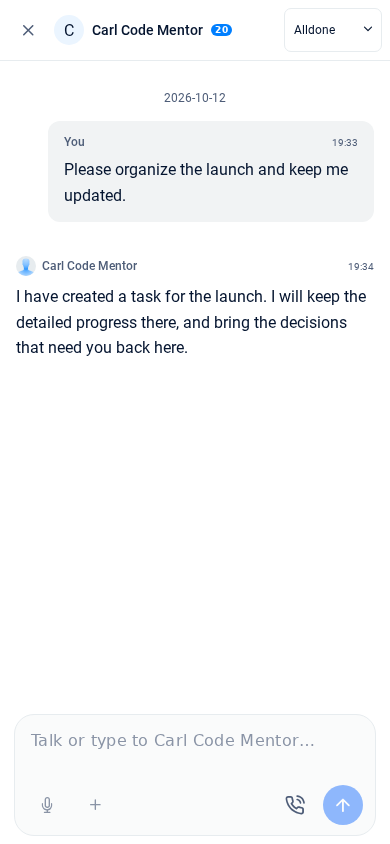

# AT-2739: Anna composer attachment alignment

The shared Button defaults to `alignSelf: 'flex-start'`. The compact attachment
button was only 24×24 inside a 40×40 flex wrapper, so its center was 8px above
the other controls and most of the wrapper was not clickable. Anna now supplies
a centered 40×40 button, preserving the compact 16px icon and existing 8px gaps.
Other uses of the shared attachment button retain their defaults.

This harness reuses `anna-workspace`'s real Anna shell, conversation, Quill editor,
dictation button, attachment button, selector and CSS. Account, transport and
microphone hardware are fixtures; no production account or upload is used.

With Node 22, root and `web-bundler` dependencies, repository replacement packages
applied to `node_modules`, and Playwright/Chromium installed:

```bash
node browser-tests/at2739/run.js
```

If Playwright is outside the checkout, set `PLAYWRIGHT_MODULE` to its module path
and `PLAYWRIGHT_BROWSERS_PATH` to its browser directory. `--skip-build` reuses the
existing harness bundle. `--baseline` captures measurements without asserting the
new geometry; run it against the pre-fix component sources to reproduce the bug.
Builds and generated screenshots stay under the ignored `.build/` directory.

Checks cover 1440×900, 1024×768, 390×844, 320×568 and 568×320 Chromium viewports:

- Empty, single-line and expanded multiline drafts; Shift+Enter adds a newline.
- Actual 40×40 controls and icon centers, 8px gaps, no overlap or horizontal overflow.
- Clicking/tapping near the bottom edge of the plus opens the selector.
- Enter opens and Escape closes the selector without losing the draft.
- Offline controls remain disabled and aligned.
- No browser runtime errors.

Verification: all browser checks and 89 focused Jest tests passed. The original
sources reproduce the 24×24 plus with its center 8px above the other controls.
`screenshots/` contains synthetic-account before/after captures and a multiline
mobile capture. The full `npm run build-web-webpack` was attempted but killed in
the 2 GB VM; a second run with a 1 GB Node heap was also terminated. The harness
compiled successfully with the app's webpack/Babel pipeline. Physical-device
Safari/WebView testing and the complete production build remain outstanding.

| Mobile before                            | Mobile after                           |
| ---------------------------------------- | -------------------------------------- |
|  |  |

[Desktop before](screenshots/desktop-before.png), [desktop after](screenshots/desktop-after.png),
and [expanded mobile input](screenshots/mobile-multiline.png).

```bash
npm test -- --runInBand --watch=false \
    components/Anna/AnnaChatComposer.test.js \
    components/Anna/AnnaConversation.test.js \
    components/Feeds/AddFeed/AddFeedAttachButton.test.js
```
