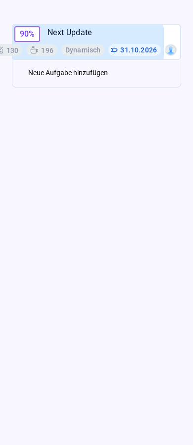
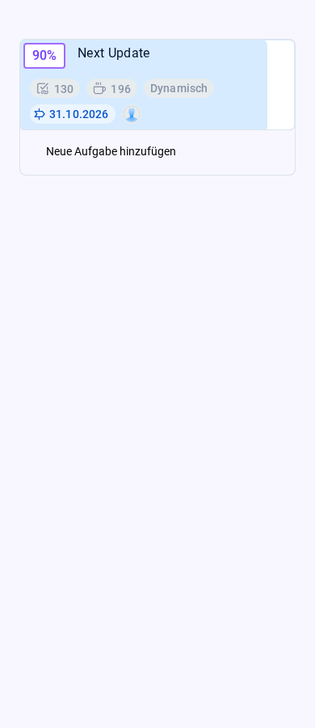

# AT-2744: Mobile goal badges

`GoalItemPresentation` positioned all badges absolutely against the right edge
and reserved only one fixed extra line. A row wider than the mobile goal card
therefore extended past its left edge. In compact navigation, badges now occupy
normal flow below the progress/title row. `GoalItemTagsArea` wraps them with an
8px row gap, so the header and progress background grow with the content.
Desktop positioning and the desktop summary toggle are retained.

This browser harness renders the real goal header, progress bars, task/coffee
counters, schedule badge, focus-area badge, milestone date, assignee badges,
Swipeable and AppPopover. Account/backend/navigation boundaries, rich title
parsing and modal contents are fixtures; it never reads or changes live data.

With Node 22, root and `web-bundler` dependencies, repository replacement
packages applied to `node_modules`, and Playwright/Chromium available:

```bash
node browser-tests/at2744/run.js
npm test -- --runInBand --watch=false \
    components/GoalsView/GoalItemPresentationSwipeGuard.test.js \
    components/UIControls/GoalDateTagButton.test.js
```

If Playwright is installed elsewhere, set `PLAYWRIGHT_MODULE` to its module
path and `PLAYWRIGHT_BROWSERS_PATH` to its browser directory. `--skip-build`
reuses the bundle. `--baseline` captures measurements without asserting the
fixed geometry; run against the pre-fix header to reproduce the overflow.
Builds, generated screenshots and measurements stay in the ignored `.build/`.

Checks cover 320, 360, 390, 430, 600, 818 and 1280px viewports:

- All badges inside the header horizontally and vertically, without overlap,
  clipping or overlap with the following task.
- Long goal and focus-area labels, including eight independently clickable
  assignees; the existing focus-area ellipsis is retained.
- Organize mode and an additional reminder-date badge at 320px.
- Task-count navigation, coffee/date navigation, schedule/progress/assignee
  popup triggers, focus-area popup and title editing remain functional.
- A mounted row resizes from phone to desktop and back without stale layout.
- No browser runtime errors.

Five focused Jest tests and all browser checks passed. The harness compiled
through the shipped webpack/Babel configuration. The original header overflowed
42px to the left at 390px and 112px at 320px; the regression assertions fail on
that source. Desktop geometry and screenshot are identical before and after.
The complete production build
and the broader `GoalsViewAllProjectsPerformance` Jest suite were attempted but
killed by the 2GB VM memory limit. Physical-device Safari/WebView verification
remains outstanding.

| Mobile before                            | Mobile after                           |
| ---------------------------------------- | -------------------------------------- |
|  |  |

[Long labels and eight assignees](screenshots/mobile-long.png),
[desktop before](screenshots/desktop-before.png),
[desktop after](screenshots/desktop-after.png).
