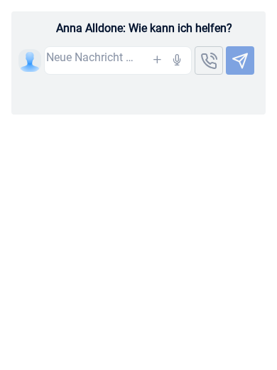

# AT-2751: Mobile assistant message positioning

Both dashboard and project assistant composers reduced mobile frame padding to
2px horizontally and 3px vertically. Their Quill text/placeholder uses a 24px
line, leaving it near the top-left of a 40px field while the controls have their
own positioning. Mobile now uses 8px horizontal and 7px vertical padding, so the
first text line centers at 20px. Auto-expand adds the full 16px frame inset
(padding plus borders), preserving bottom padding for multiline drafts. Desktop
styles and height calculation are unchanged.

The existing AT-2743 browser harness renders both production composers, Quill,
attachment/dictation and voice/send controls using synthetic account/backend
fixtures. It now loads the application's actual Quill stylesheet, including the
borderless Quill container, and blocks external requests.

With Node 22, root/web-bundler dependencies and Playwright Chromium:

```sh
node browser-tests/at2743/run.js
```

`PLAYWRIGHT_MODULE` and `PLAYWRIGHT_BROWSERS_PATH` may point to an existing
installation. `HARNESS_OUTPUT` selects the generated bundle/screenshot directory.
To capture master, run the same harness against master component sources with
`--baseline` (skips only the new positioning assertions). Then run against the
fixed sources with `DESKTOP_BASELINE` pointing to those baseline captures. Empty,
long and multiline desktop screenshots must match pixel for pixel, allowing only
1/255 per-channel antialias rounding between Chromium runs. `--skip-build` reuses
the selected output's bundle.

Checks cover both composers at 320, 360, 375, 390, 430, 600, 1024 and 1440px:
text/caret insets and control alignment, placeholder wrapping on narrow phones,
multiline growth and bottom padding, the 120px text cap and scrolling,
Shift+Enter, sending/clearing, draft preservation through mobile/desktop resize,
no horizontal overflow and no browser runtime errors.

Relevant existing Jest suites:

```sh
npm test -- --runInBand --watch=false \
  components/MyDayView/AssistantLine/assistantInputLayout.test.js \
  components/MyDayView/AssistantLine/AssistantOptions/AssistantOptions.test.js \
  components/MyDayView/AssistantLine/AssistantOptions/AssistantOptionsAttachments.test.js \
  components/TaskListView/OpenTasksView/OpenTaskViewForAssistants/AssistantInputLine.test.js \
  components/TaskListView/OpenTasksView/OpenTaskViewForAssistants/AssistantInputLineAttachments.test.js
```

Verification uses a local component harness, not an authenticated dashboard or
physical device. Microphone hardware, real uploads and production sends are
outside this visual check. The full production bundle is not built locally.
All 85 focused Jest tests and all 16 browser scenarios passed. Both baseline
and corrected harness bundles compiled with the application's webpack/Babel
pipeline. Desktop screenshot comparisons passed for both views at 1024 and 1440px.

| Mobile before                            | Mobile after                           |
| ---------------------------------------- | -------------------------------------- |
|  |  |

[Multiline mobile](screenshots/mobile-multiline.png),
[unchanged desktop](screenshots/desktop.png).
