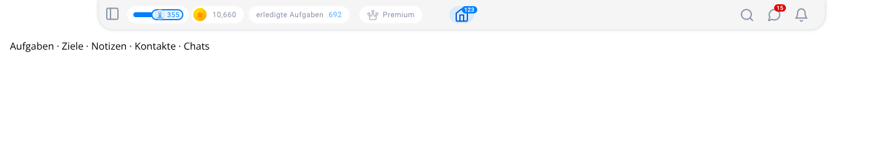
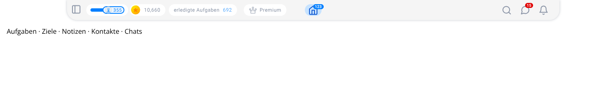
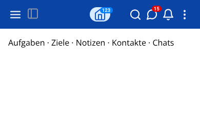

# AT-2793 — prominent Home button

Home uses the existing blue palette and Premium's 28px-high rounded shape. Its
40px width is shared with both headers' centering offsets. The badge keeps its
position relative to the icon. The existing translated "Go to home" label makes
the control accessible; TouchableOpacity retains keyboard activation, browser
focus outlines and pressed opacity. Following the review of MR !688, the previous
hover background is now the default: `UtilityBlue112` (`#D6EBFF`). Hover uses the
next darker palette shade, `UtilityBlue125` (`#C7E3FF`), and leaving the button
restores `#D6EBFF`.

Validation on Node 22.23.1:

- 20 tests passed in the existing HomeButton, TopBar, TopBarMobile,
  TopBarMobileStatisticArea and translationKeyCoverage Jest suites.
- The real header components compiled through `browser-tests/webpack.harness.js`,
  using the existing AT-2775 fixture with mocked backend/navigation and batched
  dispatch support. Chromium passed 10 cases: 320, 390, 768, 1024 and 1440px, in
  modern and classic themes. Checks covered dimensions, centering, colors, hover,
  visible keyboard focus, pressed opacity, mouse/Enter navigation, a 123-task
  badge and absence of horizontal page overflow.
- Prettier and `git diff --check` passed.
- The targeted header webpack build passed. The full production build was not
  rerun for this two-color adjustment. The base MR !688 and its post-merge
  pipeline 2973328597 were verified as merged/passed at
  `7fceca25da783567fe0831d377427f36a8cb8b95`.

Screenshots below show the real rendered headers with fixture data. The assistant
workspace/connection leaf controls and backend services are mocked.

To review in the application, run `nvm use && npm run dev`, sign in, and inspect
Home at desktop and mobile widths in both themes. Hover, Tab to it, then activate
with Enter or click; it should open the all-projects task list.
