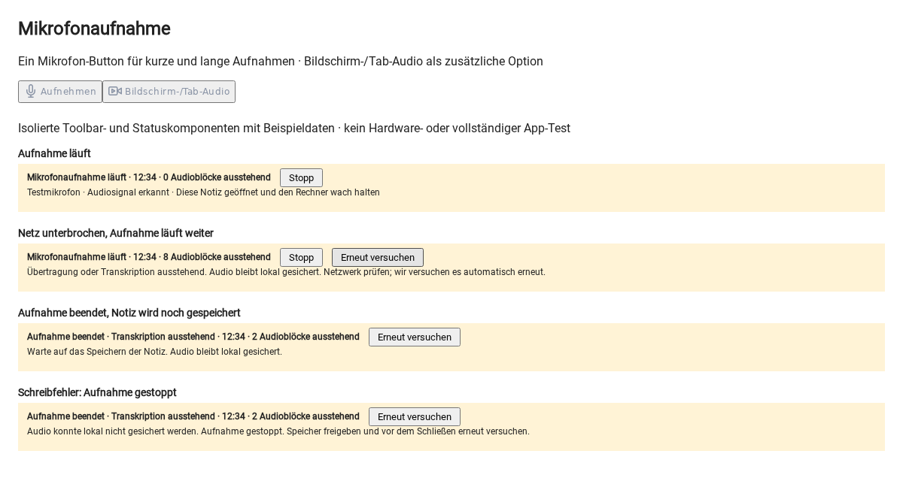

# AT-2791: Einheitliche Mikrofonaufnahme in Notizen

Ein Mikrofon-Button **Aufnehmen** im Notizeditor startet direkt das Gerätemikrofon,
ohne Auswahl zwischen Diktat und Meeting. Nach Mikrofonfreigabe sprechen, mit **Stop**
beenden; Text erscheint abschnittsweise in der Notiz. Kurze Diktate und lange Aufnahmen
nutzen denselben dauerhaften Recorder aus MR !685. Es gibt keinen zeitgesteuerten
Aufnahmestopp: weder das alte Fünf-Minuten-Diktatlimit noch das frühere 60-Minuten-Limit.
Ziel: Desktop Chrome/Edge, geöffnete Notiz, wacher Rechner. **Bildschirm-/Tab-Audio**
bleibt als zusätzliche Option einschließlich Screenshots erhalten. Während einer
laufenden Aufnahme kann der andere Audioweg nicht gestartet werden.
Das rohe Transkript wird abschnittsweise ans Notizende angehängt, ohne Zusammenfassung
oder Sprecherzuordnung. Mikrofon, Laufzeit, Signal und ausstehende Verarbeitung sind sichtbar. Starten und
Beenden haben eigene Statusanzeigen. Übertragungs-/Netzwerkfehler zeigen an, dass Audio
lokal gesichert bleibt und automatisch erneut versucht wird; **Erneut versuchen** ist
auch manuell möglich. Ein Doppelklick während der Freigabe startet keine zweite Aufnahme.

Die Notiz-Toolbar verwendet `useRambleController`/`useRambleRecorder` nicht mehr. Deren
andere Nutzer (Chat-/Aufgaben-/Assistenteneingaben, Push-to-talk, Submit-/Fokuslogik)
bleiben unverändert, einschließlich ihrer bisherigen Grenzen. Die gemeinsame
Mikrofonwahl und Kompatibilitätsprüfung in `rambleMicCapture` bleibt erhalten.
Das Notiz-Diktat verwendet jetzt das rohe, geordnete Transkript am Notizende; die alte
einmalige Assistentenbereinigung und Ersetzung an der Cursorposition entfallen.

## Aufnahme und Wiederherstellung

- Gemeinsame Geräteauswahl/Mikrofonprüfung aus `rambleMicCapture`; kein `getDisplayMedia`.
- Kontinuierlicher AudioWorklet statt Recorder-Neustarts oder einzelner `timeslice`-Fragmente.
  Letztere müssen nach der [MediaStream-Recording-Spezifikation](https://www.w3.org/TR/mediastream-recording/)
  nicht einzeln abspielbar sein. Jeder Block ist hier eine vollständige 10-Sekunden-WAV-Datei
  (mono, 16 kHz, PCM16); Stop sichert auch den kurzen Schlussblock.
- Zuerst IndexedDB-Transaktion bestätigen, dann seriell an die bestehende Deepgram-Funktion
  senden. Offline wird weiter aufgenommen. Wiederholung mit wachsendem Abstand bis 60 Sekunden.
- Pro Sitzung UUID und Abschnittsnummer; serverseitiger Ergebnis-Cache mit Inhaltsprüfung
  und Transaktions-Lease. Gold nutzt den bestehenden Idempotenzschlüssel. Preis unverändert:
  0,2 Gold/Block, etwa 72 Gold/volle Stunde. Wiederholungen desselben Blocks kosten nicht erneut.
- Transkript lokal speichern, dann Text und Übernahmemarkierung gemeinsam in Yjs schreiben.
  Erst nach bestätigtem Upload des Notiz-Snapshots in Firebase Storage wird Audio gelöscht.
  Die initiale Zusammenführung mit der gespeicherten Notiz muss vorher abgeschlossen sein.
- Erneutes Öffnen **derselben Notiz mit demselben Konto im selben Browserprofil** verarbeitet
  gespeicherte Blöcke weiter. Mikrofonzugriff startet ausschließlich nach Klick.
- Web Locks verhindern parallele Aufnahme derselben Notiz und parallele Queue-Verarbeitung
  in mehreren Tabs dieses Browserprofils. Wake Lock wird angefragt und bei Stop freigegeben.
- Freier Speicher wird vorab geprüft, dauerhafter Browserspeicher angefragt. PCM braucht
  offline ungefähr 115 MB/Stunde (110 MiB); benötigt werden mindestens 150 MiB freie Quote,
  soweit der Browser sie meldet. Audiofehler, Gold-/Zugriffsprobleme und Schreibfehler stoppen
  die Aufnahme. Bereits bestätigte Blöcke bleiben erhalten.

Grenzen: Tab-/Browserabsturz kann den noch nicht bestätigten Block (normal bis ca. 10 s)
verlieren. Bei einem Schreibfehler verbleiben ungesicherte Blöcke nur im Arbeitsspeicher:
Speicher freigeben und vor Schließen/Neuladen erneut versuchen. Browserdaten löschen entfernt
die Queue. Abgelehnte Speicherpersistenz, OS-Schlaf und Gerätefehler sind keine zugesicherte
Hintergrundaufnahme. Reines Mikrofon erfasst entfernte Teilnehmer über Kopfhörer nicht.
Unterbrechungen über Abschnittsgrenzen und Erkennungsqualität sind real zu prüfen.

Server-Cache: neue, für Clients gesperrte Collection `meetingTranscriptionResults`, ohne
Roh-Audio, mit UID, Audio-Hash, Lease und Transkript. Ergebnisse werden für Wiederholungen
aufbewahrt; dieser Prototyp führt keine automatische Löschfrist ein. Bei Cache-Schreibfehlern
kann der Anbieter erneut aufgerufen werden; Gold bleibt durch den separaten Claim idempotent.
Vor breitem Rollout muss die Aufbewahrung des Ergebnis-Caches in die bestehende
Datenlöschung einbezogen werden.

## Lokal starten und prüfen



Die Abbildung zeigt die echten Aufnahme- und Statuskomponenten im Browser mit Beispieldaten, keinen
vollständigen App- oder Mikrofontest. Reproduzierbar mit `node browser-tests/at2791/ui.run.js`
(gleiche Playwright-Voraussetzungen wie unten).

Node 22 / npm 10; vorhandene Abhängigkeiten nutzen. Fehlende Abhängigkeiten bei Bedarf mit
`npm install` im Root sowie in `functions/` und `web-bundler/` ergänzen.

```sh
npm run dev
```

Notiz mit Schreibrechten öffnen, **Aufnehmen** klicken, sprechen, **Stop** drücken.
Das Dev-Skript startet die Emulatoren. Eine echte Servertranskription benötigt die vorhandene
Deepgram-Konfiguration im lokalen Functions-Emulator; Browserprüfung und Unit-Tests benötigen
weder Schlüssel noch Produktionszugriff. Die Functions aus MR !685 müssen vorhanden sein; diese Zusammenführung ändert keine Serverfunktion. Keine neuen Umgebungsvariablen oder IAM-Rollen. Kein Deployment für diesen MR.

Gezielte Tests:

```sh
npm test -- --watch=false --runInBand --runTestsByPath hooks/useMeetingRecorder.test.js utils/meetingAudio.test.js utils/meetingCapture.test.js utils/meetingQueue.test.js components/NotesView/NotesDV/EditorView/meetingNotePersistence.test.js
node_modules/.bin/jest --config ci/jest.functions.config.js --runInBand --runTestsByPath functions/Notes/transcribeMeeting.test.js functions/Notes/deepgramTranscribe.test.js functions/Gold/goldHelper.test.js functions/Gold/goldTransactions.test.js
```

Browserprüfung ohne Hardware, Firebase oder Provider:

```sh
npm install --prefix /tmp/at2791-browser playwright
/tmp/at2791-browser/node_modules/.bin/playwright install chromium
NODE_PATH=/tmp/at2791-browser/node_modules node browser-tests/at2791/run.js
```

Dieser ca. 22-Sekunden-Test erzeugt ein Tonsignal und prüft echten AudioWorklet,
separates Dekodieren jedes WAV-Blocks, Schlussblock, wiederholten Stop, Track-Freigabe,
IndexedDB nach Reload und Reihenfolge bei simuliertem Offline-Fehler. Das ist **kein**
Geräte- oder Deepgram-Test. Unit-Tests mit mehr als 360 synthetischen Blöcken sind **kein**
einstündiger Dauertest. Die vorherige `meeting-buffer-probe.mjs` ist ein unabhängiger,
erneut ausführbarer Dateispeicher-/Zeit-Simulator und kein Nachweis für Anwendungscode.

## Manuelle 60-Minuten-Abnahme (noch offen)

- [ ] Browser-/OS-Version, Mikrofon, Netz, CPU/RAM und Ausgangsspeicher dokumentieren.
      Chrome und Edge separat prüfen; ggf. Netzteil verwenden, Rechner wach halten.
- [ ] 60 Minuten Sprache mit fortlaufenden Minutenmarkern aufnehmen; Wörter/Sätze gezielt
      über 10-Sekunden-Grenzen sprechen. Abnahme: keine unerklärten Lücken, Duplikate oder
      vertauschten Abschnitte; deutsche Erkennungsqualität bewerten.
- [ ] Fünf Minuten Netzwerk abschalten: Aufnahme läuft weiter, ausstehende Blöcke wachsen.
      Wieder verbinden: Rückstand wird vollständig abgebaut, Reihenfolge bleibt korrekt.
- [ ] Tab wechseln und zurückkehren; Signal, Laufzeit und Rückstand kontrollieren.
      CPU/RAM, lokale Audiomenge, Verarbeitungsrückstand und optional Akkuverbrauch messen.
- [ ] Während ausstehender Verarbeitung neu laden: gesicherte Blöcke werden weiterverarbeitet;
      Mikrofon bleibt aus. Nur nach bewusstem Neustart wieder aufnehmen.
- [ ] Verlorene Antwort/fehlgeschlagenen Upload simulieren: kein doppelter Text und kein
      zweiter Gold-Abzug für dieselbe Abschnitts-ID. Notizspeicherfehler hält Audio zurück.
- [ ] Mikrofon abziehen/entziehen: sichtbarer Fehler, Tracks/Wake Lock freigegeben;
      gespeicherte Blöcke bleiben erhalten. Korrektes Gerät bei erneutem Start prüfen.
- [ ] Aufnahme kurz nach einer Blockgrenze stoppen und Stop wiederholt klicken:
      Schlusswort erscheint genau einmal, Mikrofonanzeige erlischt, Pending endet bei null.
- [ ] Über fünf Minuten und über 60 Minuten hinaus aufnehmen: kein automatischer Zeitstopp.
      Danach bewusst stoppen und Schlussblock sowie Ressourcenfreigabe prüfen.
- [ ] Speicherfehler, fehlendes Gold, zweiter Tab und Kontowechsel prüfen:
      nachvollziehbarer Zustand, keine fremde Queue und kein automatischer Mikrofonneustart.
- [ ] Kurzes Diktat (auch unter zehn Sekunden) und Doppelklick auf **Aufnehmen** prüfen.
- [ ] Bildschirm-/Tab-Audio einschließlich Screenshot, Stop und Start nach Mikrofonaufnahme prüfen.

## Frühere Prüfung von MR !685 (21.10.2026)

- 174 Client-Tests in 14 Suites und 65 Server-Tests in 4 Suites bestanden, einschließlich
  bestehendem Diktat, Mikrofonwahl, Wake Lock, Notizspeicherung, Deepgram-SDK-Wireformat und Gold.
- Chromium mit erzeugtem Tonsignal: zwei vollständige 10-Sekunden-WAVs und kurzer Schlussblock,
  unabhängig dekodiert; IndexedDB, Reload, simuliertes Offline, Reihenfolge und Cleanup bestanden.
- Echte Statuskomponente mit Beispieldaten: Webpack-Harness kompiliert, deutsche Zustände,
  Stop und Retry im Browser geprüft. App-Babel-Konfiguration verarbeitet geänderte Module.
- Alte isolierte `meeting-buffer-probe.mjs` erneut ausgeführt: 360 synthetische Abschnitte und
  simulierte Fehler bestanden; kein Nachweis für echte Aufnahme oder den neuen Anwendungscode.
- `npm run build-web-webpack` durch VM-Speicherlimit beendet (Exit 137); auch Versuche mit
  weniger Parallelität/ohne Minifizierung reichten in dieser VM nicht. Vollständiger App-Build
  und vollständige Editor-Interaktion bleiben daher in CI/auf größerer Umgebung zu prüfen.

**Keine realen Mikrofon-, Provider-, Akku- oder 60-Minuten-Tests durchgeführt.** Die
Deepgram-Suite verwendet den echten SDK mit simuliertem Netzwerk. Kein Produktionsdeployment.

## Prüfung der Zusammenführung (21.10.2026)

- 166 Client-Tests in 13 Suites bestanden: gemeinsamer Recorder, Sichtbarkeit/Bedienung
  der Toolbar, Start/Stop, schneller Doppelstart während Freigabe, letzter kurzer Block,
  simulierte Aufnahme über fünf Minuten und über eine Stunde ohne automatischen Stopp,
  Offline/Online-Retry, Reload-Recovery ohne Mikrofonneustart, echte Quill/Yjs-Deduplizierung,
  Mikrofonwahl und Wake Lock. Auch die unveränderten Rambler-Diktattests bestehen.
- 65 Server-Tests in 4 Suites bestanden: Transkriptions-Cache, Deepgram-Wireformat und
  idempotente Gold-Abrechnung. Die Serverimplementierung bleibt unverändert.
- Chromium mit erzeugtem Audio: vollständige WAV-Blöcke plus kurzer Schlussblock,
  echtes IndexedDB, Reload/Offline/Reihenfolge und Track-Cleanup bestanden.
- Echte Aufnahme- und Statuskomponenten im Chromium: ein direkter Mikrofon-Button,
  separater Bildschirm-/Tab-Button, deutsche Zustände, Stop und Retry geprüft;
  aktualisierter Screenshot oben. Die Komponentenansicht wurde mit Webpack kompiliert.
- Lokaler vollständiger Produktionsbuild (`npm run build-web-webpack`) wurde in dieser
  2-GiB-VM mit Exit 143 beendet; kein erfolgreicher lokaler App-Build. CI separat prüfen.

Noch offen: echter Geräte-/Provider-Dauertest über mindestens 60 Minuten, reale
Bildschirm-/Tab-Freigabe und Screenshots im vollständigen Editor, Ressourcen-/Akkuwerte.
Die automatisierten Tests ersetzen diese Abnahme nicht. Keine Zusicherung für mobile
Hintergrundaufnahme. Keine neuen Umgebungsvariablen, Migrationen oder Serveränderungen.
Dieser MR wird weder automatisch gemergt noch deployed.
